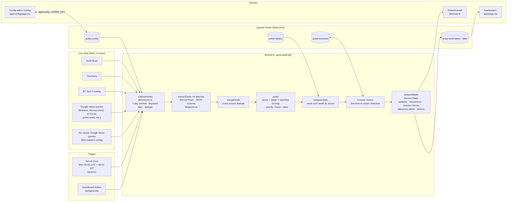

# Components Map: Startup Funding Pulse

| Component | File | Role |
|---|---|---|
| Source collector | `lib/sources.ts` | Fetches 8 fixed feeds plus up to 6 sector-specific Google News feeds built from the config. Keeps the last 7 days, filters for funding language, drops IPO and stock noise, and dedupes headlines. |
| Deal extractor (AI) | `lib/gemini.ts` → `extractDeals` | Gemini Flash with a strict JSON schema turns headlines into structured deals: company, sector (fixed taxonomy), stage, USD amount, investors, city, and which of Aarav's focus sectors the deal semantically matches. |
| Ranker | `lib/brief.ts` → `rank` | Deterministic scoring: watchlist +100, focus sector +40, focus stage +30, plus amount and source-count bonuses. Puts each deal in the priority, focus or other tier and detects watchlist companies that raised or were mentioned. |
| Stats + history | `lib/brief.ts` | Sector and stage counts, comparison with last week's brief, and investors appearing in a sector for the first time. |
| Analyst (AI) | `lib/gemini.ts` → `analyzeWeek` | Gemini Flash writes the headline, summary, cross-deal patterns, sector momentum, investor moves, **adjacency alerts** (competitors of watchlist companies) and action items. |
| Model fallback | `lib/gemini.ts` | Chain of Flash models (3.5 → 3.6 → 3-preview → flash-latest → 3.7 → flash-lite). On 503 (overloaded) or 429 (quota) it switches immediately and remembers the model that worked. Each call has a 60 s timeout and a 110 s budget. If the analysis step still fails, the brief is published with a rule-based summary instead of failing. |
| Storage | `lib/store.ts` | Upstash Redis holds the config, briefs, history and investor memory. Falls back to in-memory storage if Redis isn't connected. |
| Delivery | `lib/email.ts`, `app/page.tsx` | HTML email through Resend, and the web dashboard with an archive of past briefs. |
| Config | `app/config/page.tsx`, `app/api/config` | Aarav edits sectors, stages, watchlist (with notes) and recipient email himself. Writes are protected by `ADMIN_KEY`. |
| Scheduler | `vercel.json`, `app/api/cron` | Weekly Vercel Cron, authenticated with `CRON_SECRET`. |
