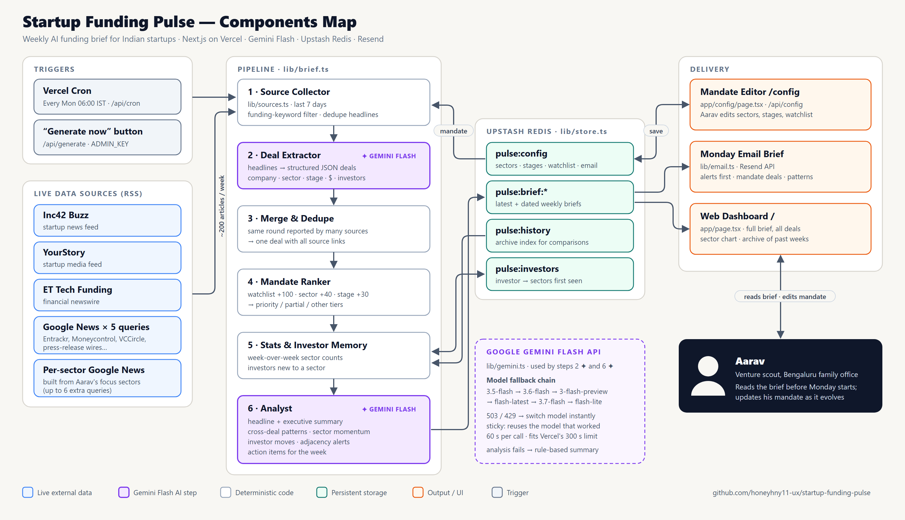

# Startup Funding Pulse

A Monday-morning brief on Indian startup funding for a venture scout. Every Monday at 06:00 IST it:

1. pulls the past 7 days of funding news from live feeds (Inc42, YourStory, ET Tech, and Google News queries covering Entrackr, Moneycontrol, VCCircle and press wires),
2. uses **Gemini Flash** to extract structured deals (company, sector, stage, amount, investors),
3. ranks them against the user's own mandate (focus sectors, focus stages, watchlist),
4. uses Gemini Flash again to find patterns, sector momentum, investor moves and **companies adjacent to the watchlist**,
5. emails the brief and publishes it on the dashboard.

The mandate is editable at `/config`. See [COMPONENTS.md](COMPONENTS.md) for the architecture.



## Environment variables

| Name | Required | Purpose |
|---|---|---|
| `GEMINI_API_KEY` | yes | From https://aistudio.google.com/apikey |
| `UPSTASH_REDIS_REST_URL` / `UPSTASH_REDIS_REST_TOKEN` | yes for persistence | Added automatically when you connect Upstash Redis from the Vercel Marketplace. `KV_REST_API_*` names also work. |
| `ADMIN_KEY` | recommended | Password for saving config and for "Generate now". |
| `CRON_SECRET` | recommended | Vercel sends it to `/api/cron` automatically. |
| `RESEND_API_KEY` | for email | From https://resend.com. With the default sender `onboarding@resend.dev`, Resend only delivers to your own Resend account email. To email anyone else, verify a domain and set `EMAIL_FROM`. |
| `GEMINI_MODEL` | no | Default `gemini-3.5-flash`. |
| `GEMINI_FALLBACK_MODELS` | no | Comma list. Default `gemini-3.6-flash,gemini-3-flash-preview,gemini-flash-latest,gemini-3.7-flash,gemini-flash-lite-latest`. The last model that worked is tried first. |

## Run locally

```bash
npm install
npm run dev
```

Put your keys in `.env.local`, open http://localhost:3000 and click **Generate brief now** (about 1 minute).

## Deploy (Vercel)

1. Import this GitHub repo at https://vercel.com/new.
2. Add `GEMINI_API_KEY`, `ADMIN_KEY`, `CRON_SECRET` and `RESEND_API_KEY` under Environment Variables, then deploy.
3. In the project, go to **Storage → Create → Upstash (Redis)**, connect it to the project, then redeploy.
4. Open `/config`, set the recipient email and admin key, then click **Save**.
5. On `/`, click **Generate brief now** so a brief exists right away. The cron then runs every Monday.
